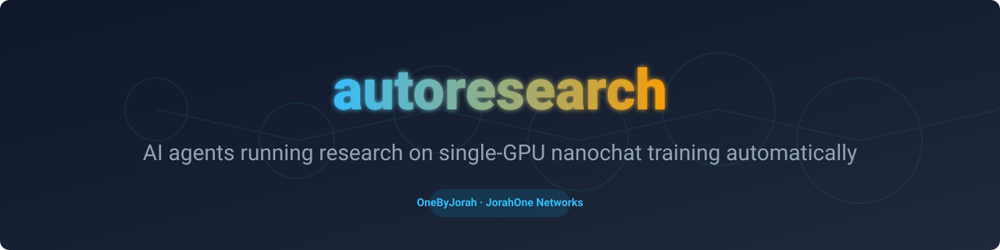
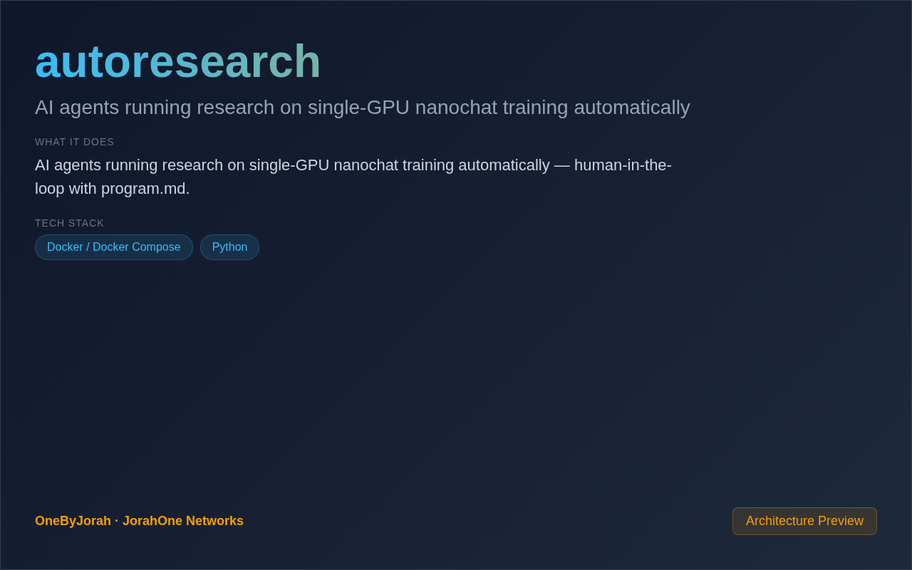
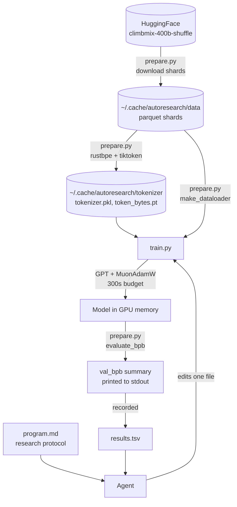

<div align="center">



# autoresearch

AI agents running research on single-GPU nanochat training automatically


</div>

---

<p align="center">
  
</p>

<br>

## Why this exists

Reproducing a pretraining result usually means a cluster, a week of wall clock, and a scheduler. autoresearch compresses the loop to one GPU and a fixed five-minute budget, with a single metric — `val_bpb` — computed by a harness the agent is not allowed to touch. That makes one experiment cheap enough to run a few times an hour, and cheap enough for an agent to try ideas unsupervised overnight. You write the research direction in `program.md`, the agent edits `train.py`, and only changes that lower `val_bpb` survive.

## Features

- **Fixed-cost experiments** — every run stops after a 5-minute training budget, so results are directly comparable.
- **One metric** — `val_bpb` (bits per byte) from `evaluate_bpb` in `prepare.py`, which is read-only for the agent.
- **Single GPU, single file** — `train.py` holds the model, the MuonAdamW optimizer, and the training loop.
- **Human-defined direction** — `program.md` is the protocol the agent follows each run.
- **Reproducible log** — every attempt is recorded in `results.tsv` (commit, score, memory, status, description).

## Quick Start

Requirements: an NVIDIA GPU (Hopper for the `varunneal/flash-attention-3` kernel, other GPUs fall back to `kernels-community/flash-attn3`), Python 3.10+, and [uv](https://docs.astral.sh/uv/).

```bash
git clone https://github.com/OneByJorah/autoresearch.git
cd autoresearch

# 1. Install uv (skip if already on PATH)
curl -LsSf https://astral.sh/uv/install.sh | sh

# 2. Install dependencies from pyproject.toml + uv.lock
uv sync

# 3. One-time data prep: download parquet shards and train the tokenizer
#    Writes to ~/.cache/autoresearch/ (use --num-shards to fetch less)
uv run prepare.py

# 4. Run one 5-minute training experiment
uv run train.py
```

`train.py` prints a summary ending in the metric:

```
---
val_bpb:          0.997900
training_seconds: 300.1
total_seconds:    325.9
peak_vram_mb:     45060.2
mfu_percent:      39.80
total_tokens_M:   499.6
num_steps:        953
num_params_M:     50.3
depth:            8
```

No checkpoints are written — the printed summary is the result. To drive the loop with an agent, hand it `program.md` and let it edit `train.py` between runs.

## Architecture



`prepare.py` owns everything fixed: constants, shard download, tokenizer training, the BOS-aligned dataloader, and the evaluation. `train.py` imports from it and owns everything the experiment may change. The agent's loop is:

1. Read `program.md` and the current `train.py`.
2. Change one thing — architecture, hyperparameters, optimizer, batch size.
3. `git commit`, then `uv run train.py > run.log 2>&1`.
4. `grep "^val_bpb:" run.log` and append the row to `results.tsv`.
5. Keep the commit if `val_bpb` improved; reset if it did not.

## Configuration

The code reads **no environment variables**. Everything is set in source:

| Setting | File | Default | Purpose |
|---------|------|---------|---------|
| `TIME_BUDGET` | `prepare.py` | `300` | Training seconds per run |
| `MAX_SEQ_LEN` | `prepare.py` | `2048` | Context length |
| `VOCAB_SIZE` | `prepare.py` | `8192` | Tokenizer vocabulary |
| `EVAL_TOKENS` | `prepare.py` | `40 * 524288` | Tokens used for the validation pass |
| `DEPTH` | `train.py` | `8` | Transformer layers |
| `DEVICE_BATCH_SIZE` | `train.py` | `128` | Micro-batch size (lower it to fit VRAM) |
| `TOTAL_BATCH_SIZE` | `train.py` | `2**19` | Tokens per optimizer step |
| `ASPECT_RATIO` / `HEAD_DIM` | `train.py` | `64` / `128` | Model width and attention head size |
| `WINDOW_PATTERN` | `train.py` | `"SSSL"` | Sliding-window attention pattern |

`prepare.py` is fixed by the rules in `program.md`; `train.py` is the file experiments are allowed to change. `train.py` also sets `PYTORCH_ALLOC_CONF=expandable_segments:True` and `HF_HUB_DISABLE_PROGRESS_BARS=1` for itself at import time, so neither needs to be exported.

## Project Structure

```
autoresearch/
├── prepare.py           # Data download, tokenizer, dataloader, evaluate_bpb (fixed)
├── train.py             # GPT model, MuonAdamW, training loop (the file agents edit)
├── program.md           # Research protocol the agent follows
├── analysis.ipynb       # Plots and outcome breakdown from results.tsv
├── pyproject.toml       # Dependencies plus the PyTorch cu128 uv index
├── uv.lock              # Locked dependency set
├── j1.yaml              # Portfolio metadata
├── Dockerfile           # uv-based image, CLI only, no web server
├── docker-compose.yml   # Single GPU service with ./data and ./output mounts
├── .env.example         # Empty template; the code reads no env vars
└── docs/assets/         # Banner and screenshot
```

## Docker

```bash
docker compose up --build
```

The compose file reserves one NVIDIA GPU and mounts `./data` and `./output`. Training reads from `~/.cache/autoresearch/`, not from those mounts, so run `uv run prepare.py` on the host or add the cache path as a volume before the container can train.

## Requirements

- Python 3.10+
- `torch==2.9.1` (cu128 index, pinned in `pyproject.toml`)
- `kernels` for FlashAttention-3, `rustbpe` + `tiktoken` for the tokenizer, `pyarrow` for shards
- The reference run in `program.md` peaks near 45 GB at the default depth of 8; reduce `DEVICE_BATCH_SIZE` or `DEPTH` if your GPU has less

## Contributing

Contributions are welcome. See [CONTRIBUTING.md](CONTRIBUTING.md) for guidelines and [CODE_OF_CONDUCT.md](CODE_OF_CONDUCT.md) for community standards. One concern per pull request, and keep changes focused enough to review in one sitting.

## Security

Report vulnerabilities privately to **security@jorahone.com** — do not open a public issue. See [SECURITY.md](SECURITY.md) for the full policy and response window.

## License

[MIT](LICENSE) © Jhonattan L. Jimenez (OneByJorah)

---

<p align="center">Built by <a href="https://github.com/OneByJorah">OneByJorah</a> · <a href="https://jorahone.com">jorahone.com</a></p>
